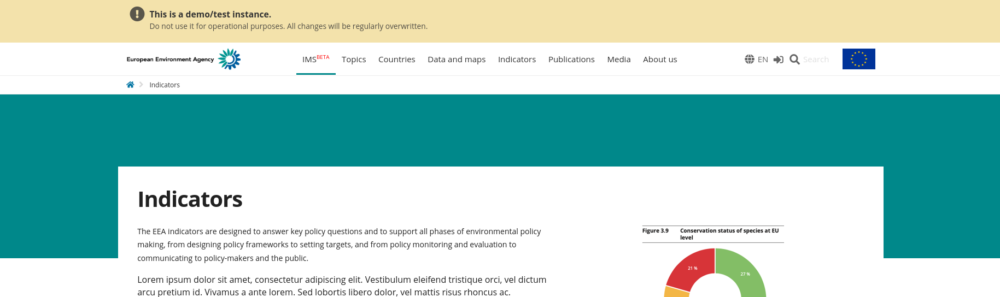

# @eeacms/volto-banner

[](https://github.com/eea/volto-banner/releases)
[](https://ci.eionet.europa.eu/view/Github/job/volto-addons/job/volto-banner/job/master/display/redirect)
[](https://sonarqube.eea.europa.eu/dashboard?id=volto-banner)

[Volto](https://github.com/plone/volto) add-on

## Features

A customizable banner to highlight to the user that the website is in demo, dev
or staging state.

It is configurable through `/controlpanel/banner`.



## Upgrades

### Upgrade to 6.x.x

> This version requires `Volto 18` or `Volto 19` and Node.js 22.

The banner keeps the same API and the same control panel settings, so upgrading from 5.x on Volto 18 needs no code changes. The release adds Volto 19 support and moves the repository to the Volto 19 layout, where the published package lives in `packages/volto-banner`.

#### Breaking changes

- **Node.js 22 or newer is required** (`engines.node >= 22`), 5.x declared no engine.
- **React 18 is required.** The package declares `react` and `react-dom` as `^18.2.0` peers, 5.x declared no peers.

The [eea.banner](https://github.com/eea/eea.banner) backend add-on is still required, as in 2.x and later. The package also declares `react-portal`, which it imports; 5.x relied on it being hoisted from the project.

### Upgrade to 2.x.x

- Version `2.x.x` requires [eea.banner](https://github.com/eea/eea.banner) Plone add-on to be installed on backend.

## Requirements

### Backend

- [Plone](https://plone.org/download)
- [plone.restapi](https://pypi.org/project/plone.restapi/)

### Frontend

- Node.js: `>=22.0.0`

## Installation

1. Make sure you have a [Plone backend](https://plone.org/download) up-and-running at http://localhost:8080/Plone

   ```Bash
   docker compose up backend
   ```

1. Start Volto frontend

* If you already have a volto project, just update `package.json`:

   ```JSON
   "dependencies": {
       "@eeacms/volto-banner": "*"
   }
   ```

   and `volto.config.js`:

   ```JavaScript
   const addons = ['@eeacms/volto-banner'];
   ```

* If not, create one with Cookieplone, as recommended by the official Plone documentation for Volto 18+:

   ```
   uvx cookieplone project
   cd project-title
   ```

1. Install or update dependencies, then start the project:

   ```
   make install
   ```

   For a Cookieplone project, start the backend and frontend in separate terminals:

   ```
   make backend-start
   make frontend-start
   ```

1. Go to http://localhost:3000

1. Happy editing!

## License

See [LICENSE.md](LICENSE.md) for details.

## Funding

[European Environment Agency (EU)](http://eea.europa.eu)
